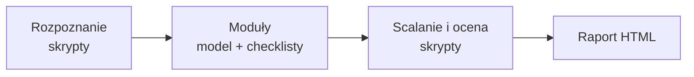

# site-review

Skill dla [Claude Code](https://claude.com/claude-code), który robi audyt strony albo aplikacji webowej w sześciu obszarach i oddaje jeden raport: ocenę 0–100 dla każdego obszaru, listę „Zrób teraz” ułożoną według wpływu i wysiłku oraz — gdy podasz repo — wskazanie `plik:linia`, gdzie leży problem.

*A Claude Code skill that audits a website or web app across SEO, speed, marketing/CRO, design & accessibility, code and Polish compliance (GDPR/cookies), and produces one scored, prioritised HTML report with file:line locations. Instructions and reports are in Polish.*

## Co sprawdza

| obszar | co konkretnie | źródło danych |
|---|---|---|
| **SEO i indeksacja** | statusy i przekierowania, `robots.txt`, sitemap, `noindex`, canonical, title/description/H1, hreflang, dane strukturalne, treść widoczna dopiero po JS | pobranie stron, porównanie HTML surowego z wyrenderowanym |
| **Szybkość** | LCP, CLS, TBT (mobile i desktop), blokujące zasoby, obrazy, cache, skrypty zewnętrzne; dane od prawdziwych użytkowników (CrUX), jeśli jest klucz | Lighthouse 13, 3 przebiegi, mediana |
| **Marketing i konwersja** | czy pierwszy ekran mówi, co to i dla kogo, wezwania do działania, sygnały zaufania, formularze, analityka | zrzuty ekranu z emulacji telefonu i komputera |
| **Design i dostępność** | kontrast, teksty alternatywne, wielkość elementów dotykowych, focus, przewijanie poziome, viewport, czytelność | Lighthouse (axe-core), zrzuty 375/768/1440 px, przeglądarka |
| **Kod** (gdy podasz repo) | renderowanie stron ważnych dla SEO, metadane we frameworku, obrazy, rozmiar bundla, podatne zależności, nagłówki bezpieczeństwa, sekrety w kodzie klienta | pliki repo |
| **Zgodność PL** | tracking i fonty zewnętrzne ładowane przed zgodą, baner cookies, polityka prywatności, klauzula RODO przy formularzach, dane firmy | ruch sieciowy z Lighthouse, HTML, zrzuty |

Moduł PL wskazuje typowe braki i nie jest poradą prawną.

## Jak działa



1. **Rozpoznanie** — skrypty pobierają strony (z poszanowaniem `robots.txt`), robią zrzuty z prawdziwą emulacją urządzenia, uruchamiają Lighthouse i porównują HTML przed i po JavaScripcie.
2. **Moduły** — dla każdego obszaru model ocenia dane według checklisty w `references/`. Jeśli w sesji jest zainstalowany specjalistyczny skill (np. `claude-seo`, `marketingskills`, `design:design-critique`), moduł z niego korzysta i jest oznaczony jako „pełny”; bez niego — „płytki”.
3. **Scalanie i ocena** — skrypty walidują znaleziska, łączą duplikaty, liczą oceny i priorytety. Liczby liczy kod, nie model, więc ta sama strona dostaje ten sam wynik.
4. **Raport** — jedna strona HTML: streszczenie dla osoby nietechnicznej, oceny obszarów, „Zrób teraz”, szczegóły z dowodami i metodologia.

Zasady, które trzymają raport w ryzach:

- **Bez dowodu nie ma znaleziska.** Każdy problem ma dowód: odpowiedź HTTP, fragment HTML, zrzut ekranu, pomiar albo `plik:linia`. Znaleziska bez dowodu trafiają do sekcji „Do weryfikacji” i nie obniżają oceny.
- **Lokalizacja w kodzie nigdy nie jest zgadywana.** Albo trafienie w pliku trasy (`pewne`), albo kandydaci (`prawdopodobne`), albo nic.
- **Porównanie z poprzednim audytem (`--recheck`) jest stabilne**: rozpoznaje tę samą stronę niezależnie od `www`/`https`, a problem znany wcześniej zachowuje swoją wagę, chyba że naprawdę się zmienił.

## Wymagania

- Claude Code
- Python 3.10+ (tylko biblioteka standardowa)
- Node.js 22+ (zrzuty ekranu przez DevTools Protocol, Lighthouse przez `npx`)
- Google Chrome albo Chromium (lub ścieżka w `CHROME_PATH`)
- opcjonalnie `PSI_API_KEY` — dane CrUX od prawdziwych użytkowników z PageSpeed Insights (wysyłane są tylko publiczne adresy)

## Instalacja

```bash
git clone https://github.com/empios/site-review.git
```

```bash
mkdir -p ~/.claude/skills
```

```bash
ln -s "$PWD/site-review/site-review" ~/.claude/skills/site-review
```

Skill pojawi się w nowej sesji Claude Code jako `/site-review`.

## Użycie

```text
/site-review https://twoja-strona.pl
/site-review https://twoja-strona.pl ~/projekty/twoja-strona
/site-review ~/projekty/twoja-strona
```

| flaga | działanie |
|---|---|
| `--quick` | tylko strona główna, bez subagentów (~5 min) |
| `--pages N` | liczba podstron (domyślnie 5, max 50) |
| `--only seo,speed,cro,design,code,pl` | tylko wybrane obszary |
| `--pl` / `--no-pl` | wymuś albo wyłącz moduł PL (domyślnie: automatycznie dla `lang="pl"` i domen `.pl`) |
| `--recheck` | porównaj z ostatnim audytem tej strony |

Pełny audyt 5 stron trwa zwykle 6–25 minut. Wyniki trafiają do `~/.site-review/<host>/<data-godzina>/` (bez repo) albo do `<repo>/.site-review/` (z repo). Raport jest publikowany jako Artifact w Claude, jeśli to narzędzie jest dostępne; w przeciwnym razie dostajesz ścieżkę do pliku HTML.

Skill nie loguje się na strony, nie wysyła formularzy i nie zmienia kodu w trakcie audytu. Na końcu proponuje naprawę trzech najszybszych poprawek — i robi to tylko po Twojej zgodzie.

## Jak liczona jest ocena

- Ocena obszaru = 100 − kary za potwierdzone znaleziska (krytyczne 25, wysokie 10, średnie 4, niskie 1).
- Wynik ogólny = średnia ważona: SEO 25, szybkość 20, marketing 20, design 20, kod 15. Obszary pominięte i zgodność PL nie wchodzą do średniej.
- Priorytet = wpływ (1–3) × waga wysiłku (S = 3, M = 2, L = 1).

Szczegóły: [`site-review/references/scoring.md`](site-review/references/scoring.md).

## Struktura

```text
site-review/
  SKILL.md               instrukcja dla Claude: tryby, kroki, granice bezpieczeństwa
  references/            checklisty modułów, katalog identyfikatorów, format znalezisk, delegacja
  scripts/               pobieranie, zrzuty, Lighthouse, scalanie, ocena, mapowanie na kod, raport
  assets/                szablon raportu HTML
tests/                   testy (unittest) i strony testowe
docs/                    projekt, plan implementacji, wyniki testu akceptacyjnego
```

## Testy

```bash
python3 -m unittest discover -s tests -t .
```

Testy zrzutów ekranu uruchamiają się, gdy są dostępne Chrome i Node 22+; bez nich są pomijane. Test akceptacyjny potrzebuje dużego obrazka, który generuje `python3 tests/fixtures/acceptance/make_assets.py tests/fixtures/acceptance`.

## Ograniczenia

- Strony za logowaniem nie są audytowane.
- Lighthouse i porównanie HTML działają na stronie startowej, zrzuty na wszystkich wybranych podstronach.
- Bez zewnętrznych skilli SEO i marketing są oceniane krótszymi checklistami („płytko”).
- Mapowanie na kod rozumie trasy Next.js, Astro, SvelteKit i Nuxt; dla innych frameworków zostaje wyszukiwanie tekstu.

## Licencja

[MIT](LICENSE)
